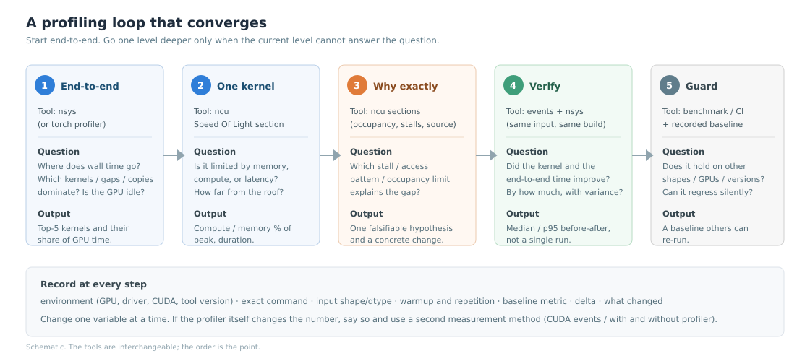
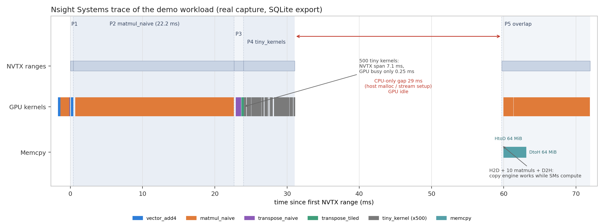

# GPU Profiling 与性能分析

本目录收录 GPU 性能分析的经验，面向**已经会做 NPU 优化、第一次认真读 GPU profile** 的工程师，也覆盖 Nsight Compute、PyTorch Profiler、监控工具和跨平台工具的常见问题。

和本库其他主题一样，条目按“症状驱动”组织：**什么现象 → 先看什么 → 根因 → 怎么修 → 怎么验证**。本页负责给阅读顺序、概念地图和边界；具体操作在条目里。

> 证据边界：Nsight Systems 的时间线/截图和本仓 demo 的数字来自真实采集（RTX 5070 + WSL2）；本机 Nsight Compute 计数器没有权限，因此 ncu 条目的 section 语义和指标名来自官方文档并用 `ncu 2026.1.1` 元数据核对，**没有本机 ncu 采集数据**。所有条目都会标明哪些是实测、哪些是文档整理。

---

## 建议阅读顺序

| 你的情况 | 阅读顺序 |
| --- | --- |
| 只做过 NPU 优化，第一次看 GPU | [NPU→GPU 概念对照](npu-to-gpu-profiling-mapping.md) → [分层定位总纲](gpu-profiling-triage.md) → [Nsight Systems 时间线](nsight-systems-timeline-reading.md) |
| 手上有一个慢模型，想尽快定位 | [分层定位总纲](gpu-profiling-triage.md) → [GPU 空转/launch](nsight-systems-gpu-idle-and-launch-overhead.md) → [Nsight Compute 第一轮](nsight-compute-first-pass.md) |
| 已经知道是某个 kernel 慢 | [Nsight Compute 第一轮](nsight-compute-first-pass.md) → [warp stall 与访存](gpu-warp-stall-and-memory-analysis.md) → [roofline/occupancy](gpu-roofline-and-occupancy.md) |
| 不确定优化是否值得 | [roofline/occupancy](gpu-roofline-and-occupancy.md) → [测量卫生](gpu-profiling-measurement-hygiene.md) |
| 想照着跑一遍 | [`toolbox/gpu-profiling-demo`](../../toolbox/gpu-profiling-demo/README.md) |

如果只读一条：读 [分层定位总纲](gpu-profiling-triage.md)。工具会换，流程不会。

---

## 三层模型

GPU 性能分析只有三层，**永远从最外层开始**：

| 层 | 回答的问题 | 主要工具 | 对应条目 |
| --- | --- | --- | --- |
| 端到端 / 系统层 | 时间花在哪些 kernel、拷贝、同步、CPU 空转上？GPU 有没有闲？ | Nsight Systems、PyTorch Profiler、`nvidia-smi` | [Nsight Systems](nsight-systems-timeline-reading.md)、[GPU 空转](nsight-systems-gpu-idle-and-launch-overhead.md) |
| 单 kernel 层 | 这个 kernel 是 memory-bound、compute-bound，还是 latency-bound？离 roof 多远？ | Nsight Compute 的 Speed Of Light / Occupancy / Warp State | [ncu 第一轮](nsight-compute-first-pass.md)、[warp stall](gpu-warp-stall-and-memory-analysis.md) |
| 微架构 / 源码层 | 具体是哪条指令、哪个访存 pattern、哪个占用率限制导致的？ | Nsight Compute Source Counters、SASS、微基准 | [访存效率](gpu-warp-stall-and-memory-analysis.md)、[SGEMM 案例](gpu-naive-sgemm-bottleneck.md) |

最常见的错误是**反着来**：一上来就 `ncu --set full` 一个 kernel，看到一堆数字，却不知道这个 kernel 在端到端里占多少时间、值不值得优化。

---

## NPU → GPU 的快速对照

完整对照和“哪里不能类比”见 [NPU→GPU 概念对照](npu-to-gpu-profiling-mapping.md)。先记住一句话：

> **GPU 靠大量 warp 做延迟隐藏，NPU 更依赖显式流水和片上存储编排；两者都怕 HBM，但“喂饱计算单元”的方式不同。**

| NPU（以昇腾为例） | GPU | 像不像 |
| --- | --- | --- |
| AI Core | SM | 近似，都是“计算簇 + 本地存储 + 调度” |
| Cube / Vector unit | Tensor Core / CUDA core | 功能近似，编程模型差别大 |
| Unified Buffer（UB） | shared memory + L1 | 都是片上 SRAM，但共享范围/bank 不同 |
| HBM | HBM / GDDR | 都是全局带宽瓶颈，分析思路一致 |
| tiling + 双缓冲 | shared-memory tiling + async copy/TMA | 目标一致，GPU 更多交给 warp 并发 |
| `msprof` / MindStudio Insight | nsys + ncu | 分层近似：时间线 + 单算子 |

---

## 可复现实验

[`toolbox/gpu-profiling-demo`](../../toolbox/gpu-profiling-demo/README.md) 是一个约 200 行的 CUDA workload，覆盖五类瓶颈：memory-bound 加法、低效 SGEMM、转置的合并访存、500 个 tiny kernel、双 stream 拷贝重叠。脚本会编译、运行、用 nsys 采集、导出统计并重绘时间线。

在本机（RTX 5070 12 GB，WSL2，驱动 616.92，CUDA 13.2）2026-11-02 的多次运行：

| 阶段 | 实测（原生） | 说明 |
| --- | --- | --- |
| vector add | 0.32–0.39 ms，510–625 GB/s（多数 0.32–0.34 / 600–625） | 多数运行达到 672 GB/s 峰值的 90%–93% |
| matmul naive | 20.4–22.6 ms / 20 次，1.9–2.1 TFLOP/s | 约为 30.9 TFLOP/s FP32 峰值的 6.2%–6.8% |
| transpose naive → tiled | 0.037–0.038 ms（220–228 GB/s）→ 0.013–0.022 ms（387–622 GB/s） | 只改 shared-memory tiling，约 2×（1.7–3.4×） |
| 500 个 tiny kernel | 3–10 ms（波动大），kernel 自身合计仅约 0.25 ms | launch/工具开销主导 |
| overlap | 10.2–11.5 ms | 10 次 matmul 与 128 MiB 拷贝重叠 |

真实 trace 的结构：

本页只给量级；具体读法见 [Nsight Systems 时间线](nsight-systems-timeline-reading.md)，数字的波动和测量方法见 [测量卫生](gpu-profiling-measurement-hygiene.md)。

---

## 症状速查

| 你看到的现象 | 先读 |
| --- | --- |
| 只会看 msprof，不知道 Nsight 从哪看起 | [NPU→GPU 概念对照](npu-to-gpu-profiling-mapping.md) |
| 能跑但慢，不知道先优化谁 | [分层定位总纲](gpu-profiling-triage.md) |
| 打开 nsys 一屏彩色条，不知道点哪 | [Nsight Systems 时间线](nsight-systems-timeline-reading.md) |
| 时间线大片空白 / GPU 利用率锯齿 | [GPU 空转与 launch](nsight-systems-gpu-idle-and-launch-overhead.md) |
| 大量 kernel 只有几微秒 | [GPU 空转与 launch](nsight-systems-gpu-idle-and-launch-overhead.md) |
| ncu 几十个 section 不知道先看哪 | [Nsight Compute 第一轮](nsight-compute-first-pass.md) |
| `ERR_NVGPUCTRPERM`，采不到计数器 | [权限与容器](gpu-profiling-permissions-and-containers.md) |
| long scoreboard / barrier 很高 | [warp stall 与访存](gpu-warp-stall-and-memory-analysis.md) |
| 带宽上不去、sectors/request 高 | [warp stall 与访存](gpu-warp-stall-and-memory-analysis.md) |
| 不确定 kernel 还有多少优化空间 | [roofline 与 occupancy](gpu-roofline-and-occupancy.md) |
| GEMM 只有峰值的几个百分点 | [naive SGEMM](gpu-naive-sgemm-bottleneck.md) |
| 用了多流/async 但没变快 | [stream 与 copy engine](gpu-multi-stream-overlap.md) |
| 结果跳动大 / profiler 下慢很多 | [测量卫生](gpu-profiling-measurement-hygiene.md) |
| 想找 top 算子 / 显存 OOM | [PyTorch Profiler](pytorch-profiler-and-memory-snapshot.md) |
| 怀疑降频 / 时钟 / 多卡拓扑 | [监控与降频](gpu-monitoring-and-throttling.md) |
| 想查命令/指标/阈值 | [命令与指标速查](gpu-profiling-cli-cheatsheet.md) |
| 手头是 AMD/Intel/Apple/TPU | [跨平台工具](gpu-other-platform-tools.md) |

---

## 条目

### 方法与模型

- [从 NPU 到 GPU：profiling 概念对照与迁移陷阱](npu-to-gpu-profiling-mapping.md)
- [GPU 性能问题分层定位总纲](gpu-profiling-triage.md)
- [roofline 与 occupancy：判断还有多少优化空间](gpu-roofline-and-occupancy.md)
- [profiling 测量卫生：预热、时钟、profiler 开销和统计](gpu-profiling-measurement-hygiene.md)

### Nsight Systems

- [第一次读 Nsight Systems 时间线](nsight-systems-timeline-reading.md)
- [GPU 空转与 launch-bound：gap 怎么归因](nsight-systems-gpu-idle-and-launch-overhead.md)
- [async 不等于 overlap：stream 与 copy engine](gpu-multi-stream-overlap.md)

### Nsight Compute 与 kernel

- [Nsight Compute 第一轮：SOL、Occupancy、Warp State](nsight-compute-first-pass.md)
- [warp stall 与访存效率](gpu-warp-stall-and-memory-analysis.md)
- [naive SGEMM 只有峰值 6%](gpu-naive-sgemm-bottleneck.md)

### 工具与环境

- [PyTorch Profiler 与显存快照](pytorch-profiler-and-memory-snapshot.md)
- [nvidia-smi、DCGM、降频和拓扑](gpu-monitoring-and-throttling.md)
- [ncu 权限、容器、WSL 和 MIG](gpu-profiling-permissions-and-containers.md)
- [AMD/Intel/Apple/TPU 工具怎么选](gpu-other-platform-tools.md)
- [命令与指标速查](gpu-profiling-cli-cheatsheet.md)

---

## 边界与版本

- 主要基于 CUDA 13.x、Nsight Systems 2025.6、Nsight Compute 2026.1、PyTorch 2.x；其他版本先用 `--help`/`--version` 核对。
- 本机 WSL2 没有开放 GPU 性能计数器，ncu 条目属于“文档 + CLI 元数据 + 通用经验”，未做本机实测；nsys 与 demo 数字是实测。
- 性能数字受 GPU、时钟、温度、WSL/容器、后台负载影响；条目里的阈值是起点，不是结论。
- 不包含私有数据、客户信息或内部链接；示例代码和截图均为本仓自建。

新增条目请按 [CONTRIBUTING.md](../../CONTRIBUTING.md) 和 [模板](../../templates/experience.md) 操作，更新本页、[条目索引](../README.md)和 `catalog.json`。
