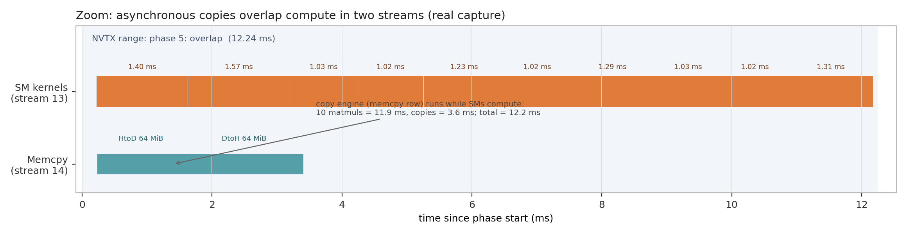

# async 不等于 overlap

> 一句话经验：**只有时间线能证明重叠；同 stream、pageable 内存、隐式同步都会让“异步”退化。**

## 适用场景

- 数据搬运和计算本该重叠，但总时间 ≈ 计算 + 拷贝；
- 用了两个 stream，但 GPU 行没有并行；
- D2H 结果要等很久；
- 不确定 pinned memory 是否生效。

不解决：多卡通信重叠（NCCL 是另一套）；也不解决 kernel 内部效率。

## 症状与信号

- 时间线上 copy 行和 kernel 行没有同时有活；
- 总时间接近 sum 而不是 max；
- `cudaMemcpyAsync` 的 API 调用很快，但 D2H 很慢；
- 使用 `.cpu()`/`.item()`/`cudaDeviceSynchronize`；
- host 内存不是 pinned。

## 快速判断

1. 拷贝和计算是否在**不同 stream**？
2. 拷贝是否依赖正在计算的同一块数据？
3. host 内存是否 pinned？
4. 是否有隐式同步（同步 `cudaMemcpy`、`.cpu()`、`cudaDeviceSynchronize`、allocator）？
5. 时间线上 copy 和 kernel 是否真的重叠？
6. 总时间是否接近 max(计算, 拷贝)？

## 根因

### 1. 同 stream 串行

同一个 stream 上的操作按顺序执行；拷贝和 kernel 在同 stream 一定串行。要重叠必须不同 stream + 正确依赖。

### 2. pageable memory

pageable host 内存的 `cudaMemcpyAsync` 可能退化为同步/分阶段拷贝；用 `cudaMallocHost`/`torch.pinned_memory`。

### 3. 隐式同步

- 同步版 `cudaMemcpy`；
- `cudaDeviceSynchronize`；
- `.item()`/`.cpu()`/`print`；
- 分配器/内存池的同步行为；
- 默认 stream 的语义。

### 4. 依赖关系错误

为了重叠而让 D2H 提前读还没算完的数据 → 结果错。必须用 event 建立依赖。

## 真实案例



本仓 demo：

- 10 次 matmul 在 stream 13，合计约 11.9 ms；
- H2D 64 MiB、D2H 64 MiB 在 stream 14，约 1.3/1.8 ms；
- 两条流并行，总时长约 12.2 ms；串行至少 15 ms。

判断：copy engine 与 SM 并行，拷贝基本被计算遮住。

```cpp
cudaStream_t s1, s2;
cudaStreamCreate(&s1);
cudaStreamCreate(&s2);

cudaMemcpyAsync(a, host_pinned, bytes, cudaMemcpyHostToDevice, s2);
for (int i = 0; i < 10; ++i)
    matmul<<<grid, block, 0, s1>>>(A, B, C, N);
cudaMemcpyAsync(host_pinned, c, bytes, cudaMemcpyDeviceToHost, s2);
cudaStreamSynchronize(s1);
cudaStreamSynchronize(s2);
```

注意：示例里 D2H 的 `c` 不依赖这 10 个 matmul；真实 pipeline 要画清依赖，别为了重叠牺牲正确性。

## 修复与规避

- 用 `cudaMemcpyAsync` + 独立 stream；
- 用 event 建立依赖（例如 D2H 等最后一次 matmul）；
- 双缓冲/分块：大拷贝切块，和计算交错；
- 确认 host 内存 pinned；
- 去掉不必要的同步点；
- 用 nsys 的时间线验证，而不是只看总时间。

## 验证

- copy 行和 kernel 行同时有活；
- 总时间接近 max(计算, 拷贝) 而不是 sum；
- 正确性：D2H 的数据在依赖的 kernel 之后；
- 端到端时间下降；
- 多流没有引入资源竞争（反而更慢）。

## 常见坑

- 同 stream 用 async，仍然串行；
- pageable 内存让 async 退化；
- 用 `.cpu()`/`.item()` 隐式同步；
- 为了重叠牺牲依赖/正确性；
- 多流导致 cache/带宽竞争，反而更慢；
- 只看 API 调用时间，不看 GPU 时间线。

## 参考

- CUDA C++ Best Practices Guide（stream/async）: <https://docs.nvidia.com/cuda/cuda-c-best-practices-guide/index.html>
- Nsight Systems User Guide: <https://docs.nvidia.com/nsight-systems/UserGuide/index.html>
- 本仓 demo: [`toolbox/gpu-profiling-demo`](../../toolbox/gpu-profiling-demo/README.md)
