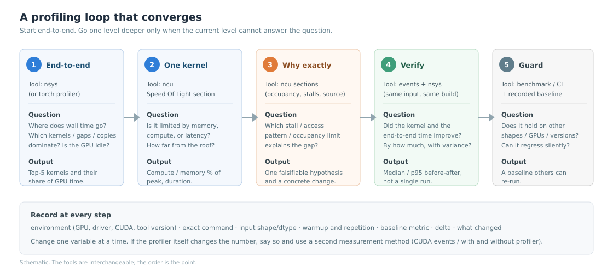

# GPU 性能问题分层定位总纲

> 一句话经验：**先算“它占端到端多少”，再决定“值不值得优化”；先端到端，后单 kernel，最后才下钻源码。**

## 适用场景

- 一个模型/服务/算子“变慢了”，但不确定是 kernel、数据、通信还是 CPU；
- 已经有一个优化候选，但不知道收益上限；
- 手里有 nsys/ncu 报告，不知道先看哪份；
- 需要向别人解释“为什么这个优化不值得做”。

不解决：具体 kernel 的微架构判读（见 [Nsight Compute 第一轮](nsight-compute-first-pass.md)）；也不替代正确性调试。

## 症状与信号

- 只盯着一个 kernel，却不知道它在总时间里占多少；
- 端到端时间波动大，先怀疑 kernel；
- 优化后 kernel 指标变好，但用户感知不到；
- 同时改了很多东西，无法归因。

## 快速判断

1. **测 baseline**：固定输入、预热、多次运行，记录中位数和 p95；
2. **算占比**：top 1 kernel 占 GPU kernel 时间多少？GPU kernel 时间占 wall time 多少？gap 占多少？
3. **看 gap**：如果 GPU 有大段空闲，先查 CPU/数据/同步，不要进 ncu；
4. **选目标**：top kernel、调用次数最多的小 kernel、或 gap 的直接原因；
5. **算上限**：如果这个目标优化 2×/10×，端到端理论上能快多少（Amdahl）；
6. **再进单 kernel**：分类、找限制项、做最小改动；
7. **回端到端验证**：kernel 变快不等于程序变快。

## 8 步流程



### Step 0：固定环境

- GPU 型号、驱动、CUDA、框架、工具版本；
- 输入 shape、dtype、batch、sequence length、随机种子；
- 是否 MIG/容器/WSL/多租户；
- 时钟/功耗策略（`nvidia-smi -q -d CLOCK,PERFORMANCE`）。

环境不固定，后面的数字都不可比。

### Step 1：测 baseline

- 端到端：多次运行，取中位数和 p95；
- 关键阶段：用 CUDA events 或 NVTX 打点；
- 记录“优化前”的完整数字，而不是只记一个总时间。

### Step 2：端到端时间线（nsys）

- top kernel、gap、copy、sync、CPU；
- 算三个比例：
  - GPU kernel 时间 / wall time；
  - top 1 kernel / GPU kernel 时间；
  - gap 总时长 / wall time。

如果 **top 1 kernel < 10%**，先别进 ncu；优化它的收益上限只有 10%。

### Step 3：选目标 kernel

优先级：

1. 占 GPU 时间最大；
2. 占比不大但调用次数极多（launch/框架开销）；
3. 已知有明确问题（非合并、spill、低 occupancy）；
4. gap 的直接原因（同步、拷贝、CPU）。

### Step 4：单 kernel 分类（ncu）

- SOL：memory / compute / latency；
- occupancy 限制项；
- 第一名 stall；
- 访存效率（sectors/request、hit rate）。

得到一个**可证伪的假设**：

> “这个 kernel 的 global load sectors/request 是 16，理想是 4；我假设把标量 load 改成 `float4` 并调整 thread 映射，能把有效带宽从 220 提到 500+ GB/s。”

假设必须包含：**证据 + 机制 + 预期结果 + 验证方法**。

### Step 5：做最小改动

- 一次只改一个变量；
- 保留正确性对拍；
- 记录改动前后的命令、输入、版本；
- 改了多个东西，无法归因。

### Step 6：验证

- 同一输入、同一 build、同一测量方法；
- 多次运行，中位数 + p95；
- 先看 kernel 指标，再看端到端；
- 如果 kernel 快了但端到端没变，检查是否被别的阶段吃掉。

### Step 7：记录与回归

- 把 baseline、命令、结果写进 PR/文档；
- 加一个可重复的 benchmark（哪怕只是一个脚本）；
- 在 CI 或定期任务里守住关键指标；
- 标注适用版本/架构。

## Amdahl：先算收益上限

如果某个阶段占端到端比例 `p`，该阶段加速 `s` 倍：

```
Speedup = 1 / ((1 - p) + p / s)
```

| 阶段占比 p | 该阶段加速 s | 端到端加速 | 说明 |
| --- | --- | --- | --- |
| 30% | 2× | 1.18×（+17.6%） | 很常见：kernel 快一倍，端到端只快 18% |
| 30% | 10× | 1.37×（+37%） | 即使 kernel 快 10 倍，也受 70% 其他部分限制 |
| 80% | 2× | 1.67×（+67%） | 值得做 |
| 5% | 10× | 1.05×（+5%） | 通常不值得 |

例子：`matmul_naive` 在本仓 demo 里占 GPU kernel 时间约 95%，优化它端到端收益明显；vector add 只占约 0.4%，优化到完美也几乎看不出。

## 按问题选工具

| 你要回答的问题 | 首选 | 对应条目 |
| --- | --- | --- |
| 端到端时间花在哪？GPU 为什么闲？ | Nsight Systems | [时间线](nsight-systems-timeline-reading.md)、[gap](nsight-systems-gpu-idle-and-launch-overhead.md) |
| Python/算子级谁慢？shape？ | PyTorch Profiler | [PyTorch Profiler](pytorch-profiler-and-memory-snapshot.md) |
| 单 kernel 被什么限制？ | Nsight Compute | [ncu 第一轮](nsight-compute-first-pass.md) |
| GPU 是否降频/健康？ | `nvidia-smi`/DCGM | [监控](gpu-monitoring-and-throttling.md) |
| 采不到计数器？ | 权限/容器 | [权限与容器](gpu-profiling-permissions-and-containers.md) |
| 跨平台？ | AMD/Intel/Apple 工具 | [跨平台工具](gpu-other-platform-tools.md) |

## 修复与规避

按瓶颈类型分流：

- **memory-bound**：减少 bytes、合并访存、提高复用；见 [访存](gpu-warp-stall-and-memory-analysis.md)；
- **compute-bound**：Tensor Core、指令混合、ILP；见 [SGEMM](gpu-naive-sgemm-bottleneck.md)；
- **latency-bound**：occupancy/ILP/预取；见 [roofline 与 occupancy](gpu-roofline-and-occupancy.md)；
- **launch/CPU-bound**：融合、CUDA Graphs、dataloader；见 [gap](nsight-systems-gpu-idle-and-launch-overhead.md)；
- **通信**：overlap、拓扑、消息大小；见 [多流](gpu-multi-stream-overlap.md) 与 monitoring。

## 验证

- 同一输入、同一 build、同一测量方法；
- 至少 5 次，报中位数/p95，不报“最好的一次”；
- kernel 指标 + 端到端都要改善；
- 正确性对拍通过；
- 记录环境和差异，方便回归。

## 常见坑

- 优化一个占比 5% 的 kernel，却宣称“提速 2×”；
- 只看 kernel 时间，忽略 gap；
- 用 profiler 下的 duration 当真实性能；
- 一次改多个变量，无法归因；
- baseline 没记录，无法判断是否真的变快；
- 不同 batch/shape/精度直接比较。

## 参考

- Nsight Systems User Guide: <https://docs.nvidia.com/nsight-systems/UserGuide/index.html>
- Nsight Compute Profiling Guide: <https://docs.nvidia.com/nsight-compute/ProfilingGuide/index.html>
- CUDA C++ Best Practices Guide: <https://docs.nvidia.com/cuda/cuda-c-best-practices-guide/index.html>
- 本仓 demo: [`toolbox/gpu-profiling-demo`](../../toolbox/gpu-profiling-demo/README.md)
