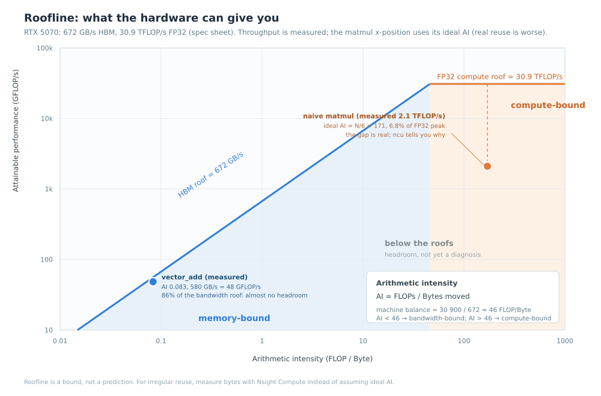

# roofline 与 occupancy：判断还有多少优化空间

> 一句话经验：**先算算术强度和机器平衡点，判断 memory/compute/latency；occupancy 是延迟隐藏的手段，不是目标。**

## 适用场景

- 优化前想估算“理论上还能快多少”；
- 不确定该减少字节、换 Tensor Core，还是提 occupancy；
- 需要向别人解释“这个 kernel 已经到 roof 了”；
- 看到 occupancy 低/MFU 低，但不知道是否值得动。

不解决：具体访存/stall 的修复（见 [warp stall 与访存](gpu-warp-stall-and-memory-analysis.md)）。

## 症状与信号

- `vector add` 已经 90% 峰值带宽，还在尝试循环展开；
- `matmul` 只有峰值 6%，不知道是 memory 还是 latency；
- occupancy 25%，但带宽已经接近峰值；
- 100% occupancy，仍然大量 stall；
- MFU 低，但 kernel 本来就不是 compute-bound。

## 快速判断

1. 算 AI = FLOP / Byte；算机器平衡点 = 峰值算力 / 峰值带宽；
2. AI < 平衡点 → memory-bound；AI > 平衡点 → compute-bound；
3. 实测点远低于两条 roof → latency-bound（或效率问题）；
4. 如果接近 memory roof → 减少字节/提高复用，不要再调指令；
5. 如果接近 compute roof → 换 Tensor Core/降精度/减少 FLOP；
6. 两者都低 → 看 occupancy、eligible warps、stall。

## roofline 公式

```
AI = 完成的 FLOP 数 / 搬运的 Byte 数
机器平衡点 = 峰值算力 / 峰值带宽
```

以 RTX 5070 为例：FP32 峰值约 30.9 TFLOP/s，HBM 672 GB/s，平衡点约 **46 FLOP/Byte**。



- AI < 46：memory-bound，算力不是瓶颈；
- AI > 46：compute-bound，优化计算效率；
- 点同时远低于两条 roof：latency/occupancy/依赖问题。

### 本仓实测点

- **vector add**：每次加法按 1 FLOP 计，AI = 1/12 ≈ 0.083；实测 615–625 GB/s → 约 51–52 GFLOP/s，达到带宽 roof 的 92% 左右。已在 roof 附近，继续调指令没有意义；要提速只能减少搬运（融合、量化）。
- **naive matmul**：理想 AI = N/6 ≈ 171（N=1024，假设完美复用），实测 1.9–2.1 TFLOP/s，只有 FP32 roof 的 6%–7%。它离 compute roof 很远，但 roofline 只告诉你“有差距”，不告诉你“为什么”；需要 ncu 的 occupancy/stall/memory 数据。

## roofline 的三个误用

1. **把峰值当可达**：实际可达通常是峰值的 70%–90%（时钟、功耗、指令混合）；
2. **用理想 AI 代替实测字节**：transpose/attention 的实际 HBM 流量往往远大于“最少需要搬多少”；
3. **只看总带宽，不看时间线**：kernel 可能只有 30% 时间在访存，其余在等延迟。

## occupancy：手段不是目标

### 三个数字

- **Theoretical**：按资源算出的最大驻留 warp 比例；
- **Achieved**：实际平均驻留比例；
- **Active warps/SM**：绝对值，便于和硬件上限对照。

### 一个具体例子

假设 SM 有 64 warp 槽位、65 536 寄存器、228 KB shared memory（不同架构不同）。kernel 用 256 线程/block（8 warp）、64 寄存器/线程、48 KB shared mem/block：

- 寄存器：65 536 / (256×64) = 4 block；
- shared mem：228 KB / 48 KB = 4 block；
- warp：4×8 = 32 → 理论 occupancy 50%。

寄存器降到 32/线程，寄存器限制变成 8 block，但 shared mem 仍限制 4 block → occupancy 仍 50%。**只看寄存器不够，要找真正的限制项。**

### 限制项

- Registers：每线程寄存器 × 线程数 ≤ SM 寄存器文件；
- Shared memory：每 block 静态+动态+对齐；
- Warps/Blocks：硬件上限；
- Barriers：per-block barrier 资源。

限制项是 shared mem，降寄存器没用；限制项是寄存器，减 shared mem 也没用。

### 提高 occupancy 的手段与代价

| 手段 | 收益 | 代价 |
| --- | --- | --- |
| 降寄存器（`__launch_bounds__`、减少 live values） | 更多 block | 可能 spill |
| 减小 block | 更细调度 | launch/调度开销、复用下降 |
| 减少 shared mem/block | 更多 block | 复用下降、bank conflict 可能增加 |
| 增大 grid | 填满 GPU | 尾部和调度开销 |

**先看 stall**：如果第一名是 `not_selected`，说明 warp 足够多，再加 occupancy 不会更快。

## Little's law：需要多少并发

```
需要的并发请求数 ≈ 带宽 × 延迟
```

HBM 延迟按 600 ns、带宽 672 GB/s 估算：需要约 400 KB 数据在飞行中才能打满带宽。分摊到 48 个 SM，每 SM 约 8.4 KB；按 32 B sector 算，约 260 个未完成 sector 请求/SM。

这解释了：

- memory-bound kernel 需要足够 warp 和 outstanding loads；
- 但 occupancy 不是越高越好：如果每线程有足够 ILP，低 occupancy 也能打满带宽；
- 100% occupancy 的 kernel 如果每个 warp 都在等同一个依赖，还是会 stall。

## 修复与规避

- **到 memory roof**：减少字节（融合/量化/复用）、提高合并度；不要再调指令；
- **到 compute roof**：Tensor Core、降低精度、减少 FLOP、提高 ILP；
- **两者都低**：提 occupancy（按限制项）或 ILP/预取；
- **不确定**：先用 ncu 拿实测 bytes/FLOPs，再放到 roofline 上。

## 验证

- 重新计算有效带宽/GFLOPS；
- 确认 AI 和 roof 的位置变化；
- 端到端收益在方差之外；
- 正确性对拍（尤其换精度/Tensor Core）。

## 常见坑

- 把“峰值”当“可达”；
- 用理想 AI 代替实测字节；
- 只看 occupancy 数字，不看 stall；
- 用错 dtype 的 peak；
- 优化一个已经到 roof 的 kernel；
- 把 MFU 低当成“必须优化这个 kernel”。

## 参考

- Nsight Compute Kernel Profiling Guide（roofline/SOL）: <https://docs.nvidia.com/nsight-compute/ProfilingGuide/index.html>
- CUDA C++ Best Practices Guide（occupancy）: <https://docs.nvidia.com/cuda/cuda-c-best-practices-guide/index.html>
- 本仓 demo: [`toolbox/gpu-profiling-demo`](../../toolbox/gpu-profiling-demo/README.md)
