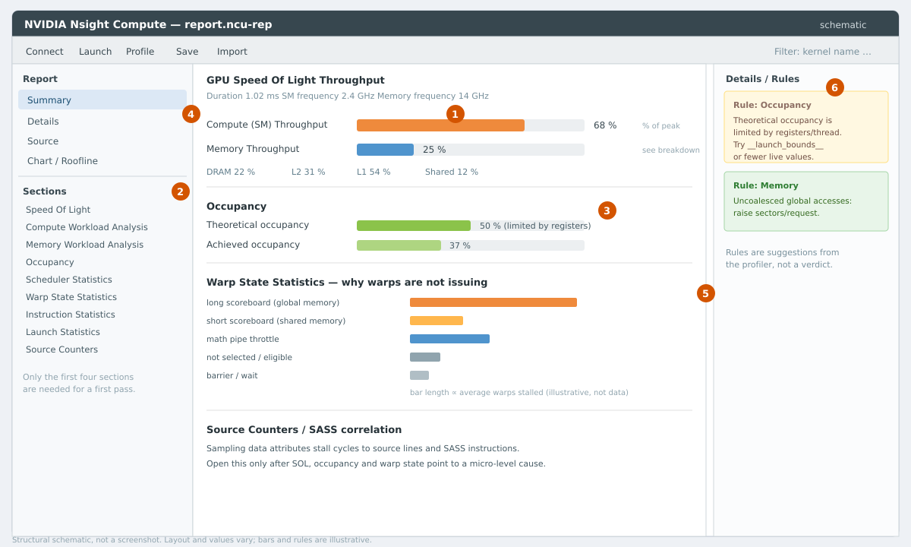

# Nsight Compute 第一轮

> 一句话经验：**先看 Speed Of Light 分类，再看 Occupancy 限制项，最后看第一名 warp stall；不要一上来读所有 section。**

## 适用场景

- 已用 nsys 确认某个 kernel 值得优化（见 [分层定位总纲](gpu-profiling-triage.md)）；
- 需要判断 kernel 是 memory-bound、compute-bound 还是 latency-bound；
- 需要知道 occupancy 被什么限制、warp 在等什么。

不解决：端到端时间分布（用 nsys）、Python/CPU 开销（用 PyTorch Profiler）。

## 症状与信号

- 打开报告看到几十个 section，不知道顺序；
- “Memory 90%”但不确定是 DRAM 还是 L1；
- occupancy 很低，直接调 block 却更慢；
- `ncu` 第一次运行报 `ERR_NVGPUCTRPERM`；
- replay 后的 duration 和 nsys/CUDA events 对不上。

> **证据边界**：本机 WSL2 没有开放 GPU 性能计数器，本文的 section 语义/指标名来自官方文档并用 `ncu 2026.1.1 --list-sets`、`--query-metrics --chip gb205` 核对，**没有本机采集截图或数字**。§6 的判读示例是假设场景，不是实测。

## 快速判断

1. 权限是否正常？先解决 `ERR_NVGPUCTRPERM`（见 [权限与容器](gpu-profiling-permissions-and-containers.md)）；
2. 先 `--set basic`，不要 `full`；
3. 看 SOL：Compute 高还是 Memory 高？
4. 看 Occupancy：理论/实际、限制项；
5. 看 Warp State：第一名 stall；
6. 需要时再看 Memory/Compute/ Source。

## 根因：为什么不能直接读所有 section

- 指标太多，硬件需要**多次 replay** 才能采完；每次 pass 可能清 cache、抬时钟；
- `--set full` 的 pass 数多，duration 和真实运行偏差更大；
- 没有分类先验，看到 50 个百分比无法判断哪个重要；
- 不同 dtype/架构的 peak 不同，用错 roof 会得出相反结论。

## 采集之前

### 性能计数器权限

```text
==ERROR== ERR_NVGPUCTRPERM - The user does not have permission to access
NVIDIA GPU Performance Counters on the target device 0.
```

处理方式（需要管理员权限，按环境策略）：

- **Linux 裸机**：`/etc/modprobe.d/` 加 `options nvidia NVreg_RestrictProfilingToAdminUsers=0`，重启或重载驱动；
- **Windows**：NVIDIA 控制面板 → Developer → Manage GPU Performance Counters → 允许所有用户；
- **容器**：透传性能计数器权限（常见 `--cap-add=SYS_ADMIN`），`NVIDIA_DRIVER_CAPABILITIES=compute,utility`；
- **MIG**：只能分析当前实例的 SM，部分指标不可用；
- **WSL2**：很多版本不开放，本机就是如此；只能在原生 Linux/Windows 采，或退回 nsys + CUDA events。

### Replay

一个 kernel 的指标太多，ncu 默认多次 replay 同一个 kernel：

- `--cache-control all`（默认）每次 pass 前清 cache → L2 命中率偏低；`none` 保留 cache，但可能偏离真实执行顺序；
- `--clock-control boost`（默认）锁 turbo；做性能结论用 `base`，并用关掉 profiler 的 CUDA events 复核；
- 有状态 kernel（原子累加、随机数）用 `--replay-mode application`；
- `--set full` 可能十几到几十个 pass；先 `basic`/`detailed`。

### 选 kernel

```bash
ncu --set basic -k regex:matmul_naive -c 1 ./app
ncu --set detailed -k regex:matmul_naive -s 5 -c 1 ./app
ncu --target-processes all --set basic ./app
```

`-s` 跳过预热，`-c` 限制采集次数。先确认采到的是稳态。

## 界面结构



> 结构示意图，不是截图；布局随版本变化，但信息层级一致。

| 编号 | 区域 | 作用 |
| --- | --- | --- |
| 1 | Speed Of Light 两条 bar | 第一眼判断 compute/memory 谁接近峰值 |
| 2 | Sections 列表 | 按顺序展开 |
| 3 | Occupancy | 理论/实际 occupancy 与限制项 |
| 4 | Report 页面 | Summary / Details / Source / Chart |
| 5 | Warp State | warp 卡在哪种 stall |
| 6 | Details / Rules | profiler 建议，是线索不是结论 |

推荐顺序：SOL → Launch/Stats/Occupancy → Scheduler/Warp → Memory/Compute → Source/Instruction → Chart/Roofline → Rules。

## Speed Of Light：第一眼分类

- **Compute (SM) Throughput**：SM 各计算 pipe 的实际吞吐占该 pipe 峰值的百分比，通常取最忙的 pipe；
- **Memory Throughput**：L1/L2/DRAM 子系统的吞吐占各自峰值，UI 有 breakdown；
- **Duration**：kernel 时间；SOL 按 elapsed/active cycles 归一化，注意口径。

**关键：分母是峰值，不是运行时间。** “Memory 80%”= 内存子系统达到峰值的 80%，不是“80% 的时间在访存”。

| Compute | Memory | 分类 | 典型动作 |
| --- | --- | --- | --- |
| 高（>60–70%） | 低 | compute-bound | 减少指令、Tensor Core/更快 dtype、提高 ILP |
| 低 | 高（>60–70%） | memory-bound | 减少字节、合并访存、提高复用、shared memory |
| 高 | 高 | balanced/双瓶颈 | 算法级改动（分块、融合、降低精度） |
| 低 | 低 | latency-bound | 看 occupancy、eligible warps、stall；增加并发或 ILP |

阈值不是绝对的：30% memory 的 kernel 也可能因延迟而慢；70% compute 也可能已接近实际可达峰值。象限只用于选下一步看哪个 section。

## Section 逐个看

| Section | 回答的问题 | 先看什么 | 典型信号 → 动作 |
| --- | --- | --- | --- |
| **SpeedOfLight** | 整体 memory 还是 compute 限制？ | Compute/Memory、DRAM/L1/L2 breakdown | 见上 |
| **LaunchStats** | grid/block 多大？寄存器/shared 多少？多少 wave？ | Grid、Block、Registers/Thread、Shared Mem/Block、Waves | 小 grid → 并行度不足；wave 尾数大 → tail |
| **Occupancy** | 理论/实际能驻留多少 warp？被什么限制？ | Theoretical vs Achieved、Block Limit | 按限制项调整 |
| **SchedulerStats** | 每周期多少 eligible warp？issue 满了吗？ | Eligible Warps/Cycle、Issue Slot、Active Warps | eligible <1 → latency-bound |
| **WarpStateStats** | warp 不 issue 时等什么？ | 各类 stall 的 average/proportion | 看第一名，见 [stall 条目](gpu-warp-stall-and-memory-analysis.md) |
| **MemoryWorkloadAnalysis** | 访存效率如何？哪里浪费？ | Sectors/Request、L1/L2 hit、DRAM bytes、bank conflict | sectors 高 → 非合并 |
| **ComputeWorkloadAnalysis** | 哪个计算 pipe 忙？ | Pipe Utilization（FMA/ALU/LSU/Tensor） | 某 pipe 接近 100% → 该 pipe 瓶颈 |
| **InstructionStats** | 指令数、IPC、分支效率 | Executed Instructions、IPC、Branch Efficiency | 指令太多 → 简化/向量化 |
| **SourceCounters** | 哪行源码/SASS 产生 stall？ | Stall sampling、per-line metrics | 定位到具体 load/分支/循环 |
| **Roofline/Chart** | 在 roofline 的什么位置？ | AI、achieved FLOP/s、roof | sanity check |

> section 名称和可用性随 ncu 版本/架构变化；用 `ncu --list-sections` 查本机。

## Occupancy

- **Theoretical**：按资源（寄存器、shared mem、block/warp 上限）算出的最大驻留 warp 比例；
- **Achieved**：实际平均驻留比例；
- **Active warps/SM**：绝对值，便于和硬件上限对照。

限制项：Registers、Shared memory、Warps/Blocks、Barriers。先确认限制项，再决定调什么：限制项是 shared mem，降寄存器没用；限制项是寄存器，减 shared mem 也没用。

提高 occupancy 的手段与代价：

| 手段 | 收益 | 代价 |
| --- | --- | --- |
| 降寄存器（`__launch_bounds__`、减少 live values） | 更多 block | 可能 spill，反而更慢 |
| 减小 block | 更细调度 | launch/调度开销、复用下降 |
| 减少 shared mem/block | 更多 block | 复用下降、bank conflict 可能增加 |
| 增大 grid | 填满 GPU | 尾部和调度开销 |

**先看 stall 再决定。** 如果第一名是 `not_selected`，说明 warp 足够多，再加 occupancy 不会更快。

## 判读示例（假设场景，非本机数据）

**memory-bound**

```text
Compute 22% | Memory 81% | DRAM 78% | L1 65%
Occupancy: theoretical 75%, achieved 68%
Warp stall: long_scoreboard 45%
Global load sectors/request: 4.0（理想）
```

判断：DRAM 接近峰值，访存已合并，数据量太大 → 减少 bytes 或提高 L2 复用；继续调 occupancy 收益有限。

**compute-bound**

```text
Compute 88% | Memory 35% | DRAM 20%
Occupancy: theoretical 50%, achieved 47%
Compute pipe: FMA 91%
```

判断：FP32 FMA pipe 接近峰值 → Tensor Core/降精度/减少 FLOP。

**latency-bound**

```text
Compute 18% | Memory 20%
Occupancy: theoretical 25%, achieved 24%
Eligible warps/cycle: 0.4
Warp stall: long_scoreboard 60%
```

判断：occupancy 低且 warp 等内存 → 提 occupancy 或 ILP/预取；先做 occupancy，再看 stall 是否下降。

## CLI

```bash
ncu --set basic -k regex:matmul_naive -c 1 -o matmul_basic ./app
ncu --set detailed -k regex:transpose_naive -c 1 -o transpose_detailed ./app
ncu --section SpeedOfLight --section Occupancy --section MemoryWorkloadAnalysis \
    -k regex:matmul_naive -c 1 ./app

ncu --metrics gpu__time_duration.sum,\
sm__throughput.avg.pct_of_peak_sustained_elapsed,\
dram__throughput.avg.pct_of_peak_sustained_elapsed,\
sm__warps_active.avg.pct_of_peak_sustained_active \
    -k regex:matmul_naive -c 1 ./app

ncu -i matmul_basic.ncu-rep --page details --print-details all
ncu -i matmul_basic.ncu-rep --page source --print-source sass
ncu -i matmul_basic.ncu-rep --page raw --csv
```

`--list-sets`、`--list-sections`、`--query-metrics --chip <chip>` 查本机元数据。`--clock-control` 只有 `base`/`boost`/`force-boost`（2026.1 无 `none`）。

## 验证

- 能说出目标 kernel 的 SOL 分类；
- 能指出 occupancy 的限制项；
- 能把第一名 stall 和 Memory/Compute 证据对上；
- 优化后用 `--clock-control base` + CUDA events 复核；
- 回 nsys 确认端到端收益。

## 常见坑

1. 用 `--set full` 一次采所有指标；
2. 拿 replay 后的 duration 当真实性能；
3. 忽略 warmup；
4. 把 SOL 当“时间占比”；
5. 看到 long scoreboard 就加 occupancy；
6. 把 `not_selected` 当瓶颈；
7. 在 MIG/容器/WSL 里采不到计数器就怀疑 kernel；
8. 不同 dtype 的 peak 用错；
9. 用单 kernel 的 2× 提升宣称端到端 2×；
10. 忽略数值正确性。

## 参考

- Nsight Compute 文档入口: <https://docs.nvidia.com/nsight-compute/>
- Nsight Compute CLI: <https://docs.nvidia.com/nsight-compute/NsightComputeCli/index.html>
- Nsight Compute Kernel Profiling Guide: <https://docs.nvidia.com/nsight-compute/ProfilingGuide/index.html>
- CUDA C++ Best Practices Guide: <https://docs.nvidia.com/cuda/cuda-c-best-practices-guide/index.html>
