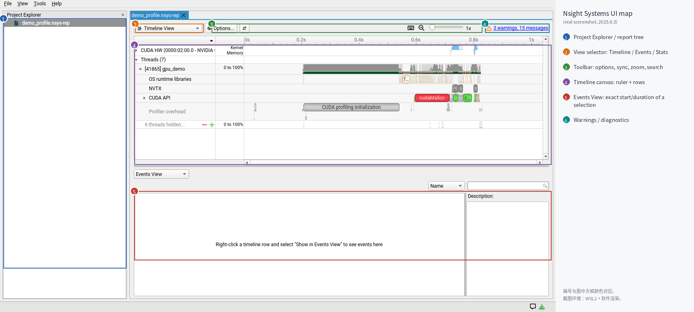
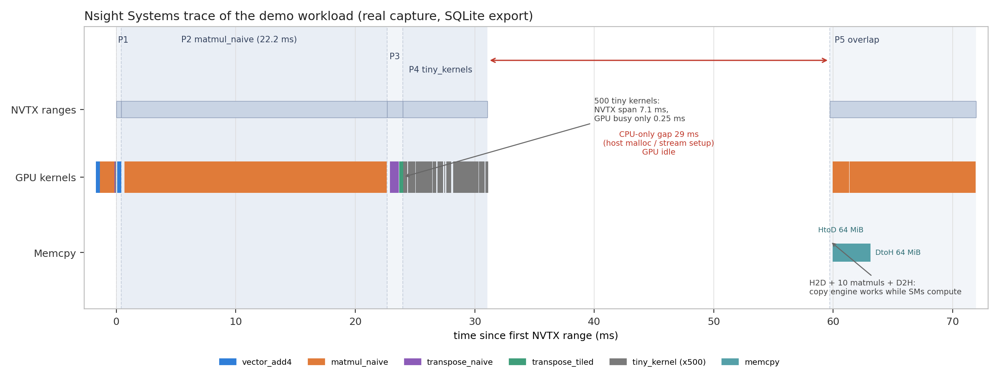
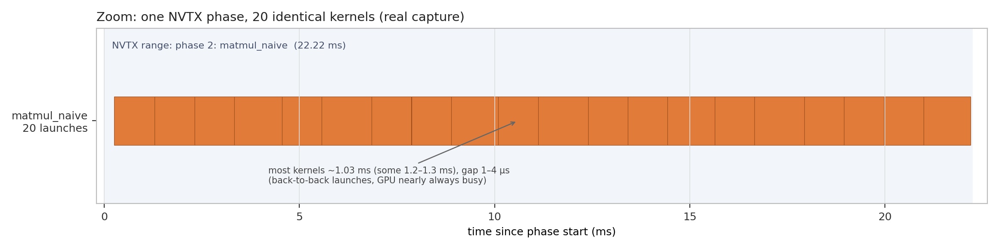
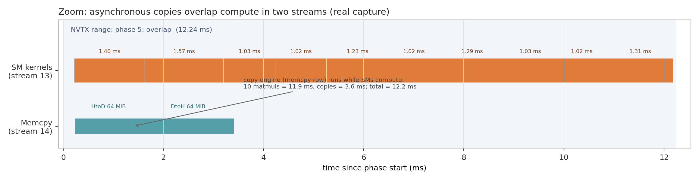
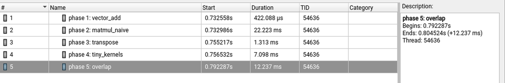

# 第一次读 Nsight Systems 时间线

> 一句话经验：**先看 CUDA HW 行的“空白”和 top kernel，再看 CPU/API 行解释它；Time% 是占 GPU kernel 时间的比例，不是占 wall time。**

## 适用场景

- 你有一个 `.nsys-rep` 或准备采集，想快速得到“时间花在哪”；
- 需要判断 GPU 为什么空转、拷贝是否重叠、launch 是否过多；
- 需要在没有 GUI 的远程/容器环境用 `nsys stats` 定位。

不解决：单 kernel 的 micro-arch 瓶颈（见 [Nsight Compute 第一轮](nsight-compute-first-pass.md)）。

## 症状与信号

- 时间线一屏彩色条，不知道从哪看；
- GPU 行大片空白，但 CPU 看起来在忙；
- 一个 kernel 名字出现几千次，每次只有几微秒；
- `nsys stats` 的 Time% 和端到端时间对不上；
- Events View 里 Start 是绝对值，不知道和总时长什么关系。

## 快速判断

1. Fit to screen，先看总时长和 GPU 行的密度；
2. `nsys stats` 找 top kernel；
3. 找最大 gap，看同一时间的 CPU/API；
4. 区分一个大 kernel 和很多小 kernel；
5. 看 memcpy 与 kernel 是否重叠；
6. 读 Events View 的精确 duration；
7. 看 warnings，记录 baseline。

## 界面地图



| 编号 | 区域 | 作用 |
| --- | --- | --- |
| 1 | Project Explorer / report tree | 打开的报告、多个 session |
| 2 | View selector | Timeline / Events / Stats / Analysis / Diagnostics |
| 3 | Toolbar | Options、同步、缩放、搜索、过滤 |
| 4 | Timeline canvas | 时间标尺 + 行（GPU / CPU / NVTX / API） |
| 5 | Events View | 选中事件的精确 start/duration/grid/block |
| 6 | Warnings / diagnostics | 采集或分析告警 |

常用操作：

| 操作 | 效果 |
| --- | --- |
| `Ctrl` + 滚轮 | 以鼠标位置为中心缩放时间轴 |
| 右键 → Fit to screen | 回到全局视图 |
| 右键 → Go to Range… | 输入起止时间，跳到精确区间 |
| 右键 → Reset Zoom / `Backspace` | 重置/撤销缩放 |
| 双击 range | 选中并把事件列到 Events View |
| 拖拽底部滚动条 | 左右平移 |

> 截图来自本仓实验（WSLg + 软件渲染），个别行文字与色块有轻微错位，但面板位置和真实 UI 一致。

## 时间线每一行是什么

| 行 | 内容 | 读它回答什么 |
| --- | --- | --- |
| **CUDA HW** | GPU 上真正执行的 kernel、memcpy、memset、sync | GPU 忙不忙？在跑什么？ |
| CUDA HW 展开后的 **Stream 行** | 每个 stream 上的 kernel / copy | 多流是否并行？copy engine 是否空闲？ |
| **Threads / 进程行** | CPU 线程采样（running/sleeping） | CPU 是否成为瓶颈？哪个线程在忙？ |
| **OS runtime libraries** | `pthread`、`poll`、`read` 等 | 是否卡在 IO/锁/系统调用？ |
| **NVTX** | 你手动打的 range | 把 GPU 时间和业务阶段对应起来 |
| **CUDA API** | `cudaLaunchKernel`、`cudaMemcpy`、`cudaMalloc`、同步 | 谁在发命令？谁在等？ |
| **Profiler overhead** | 采集本身的开销 | 这段数据可信吗？ |

容易误读的点：

- **CUDA HW 行的空白才是重点**：空白 = GPU 没活干，要看同一时间 CPU 在干什么；
- **颜色不是语义**：kernel 颜色由报告自动分配，用 tooltip/Events View 看名字；
- **时间轴原点是 session 开始，不是进程开始**；比较阶段时用 duration；
- **同一个 kernel 被 launch 多次会显示多个块**，放大后才能看出是一个长 kernel 还是很多短 kernel。

### 自己打 NVTX

NVTX 是让时间线“说人话”的最便宜手段。没有它只能看到 kernel 名；有了它能看到“数据加载 / forward / backward / 通信”各占多久。

```cpp
// C/C++（CUDA 11.6+ 用 nvtx3/nvToolsExt.h；链接 libnvtx3interop 或 libnvToolsExt）
nvtxRangePushA("dataloader");
// ...
nvtxRangePop();
```

```python
# PyTorch
import torch
torch.cuda.nvtx.range_push("forward")
# ...
torch.cuda.nvtx.range_pop()

with torch.profiler.record_function("attention"):
    ...
```

命名建议：**阶段 + 关键 shape/batch**，例如 `forward bs=8 seq=2048`。

## 10 分钟读图例程

目标：得到三个结论——top 3 时间消耗、最大 gap 的原因、GPU 是否被 kernel 打满。

### 第 1 分钟：看总量

- Fit to screen，记住总时长；
- 看 CUDA HW 行的密度：大片空白就先别急着看 kernel；
- 看进程列表，确认没有混入无关进程。

### 第 2–3 分钟：找 top kernel

切到 **Stats** 视图，或：

```bash
nsys stats --report cuda_gpu_kern_sum report.nsys-rep
```

按 `Time (%)` 排序，记下前 3 个。**Time% 是占 GPU kernel 总时间的比例，不是 wall time。**

### 第 4–5 分钟：找最大 gap

找 CUDA HW 行最长的连续空白，放大到能看见边界，然后看同一时间：

- CUDA API 行是否有长条（`cudaMalloc`、`cudaDeviceSynchronize`、`cudaStreamSynchronize`）？
- CPU 线程是否 running？
- 是否在等 IO/锁/数据加载？

gap 前紧挨着 `cudaDeviceSynchronize` → 同步等待；gap 期间 CPU 在跑 Python/预处理 → host-bound；gap 出现在启动阶段 → 模块加载/JIT/allocator。

### 第 6–7 分钟：大 kernel 还是很多小 kernel

- 一个块持续几毫秒 → 值得进 ncu；
- 成百上千个 <10 µs 的块 → 先考虑 launch overhead/融合/CUDA Graphs，而不是逐 kernel 优化。

### 第 8–9 分钟：拷贝和 overlap

- memcpy 和 kernel 是否在同一 stream？同 stream 会串行；
- copy engine 行是否在 kernel 运行时也忙？
- H2D/D2H 是否阻塞？`cudaMemcpy` 同步版会阻塞 host，`cudaMemcpyAsync` 才可能异步。

### 第 10 分钟：warnings 和 baseline

记录：总时长、top 3 kernel、最大 gap、GPU busy 比例、版本/时钟。没有这些，后面的“优化”无法比较。

## 常见 pattern

| 时间线现象 | 可能原因 | 下一步 |
| --- | --- | --- |
| CUDA HW 大片空白，CPU running，API 密 | CPU launch-bound / Python 开销 | 减少 launch、融合、CUDA Graphs |
| 空白前后有长同步调用 | 同步点太多/隐式同步 | 去掉不必要的 `.item()`/`.cpu()`/print |
| 每个 kernel 几微秒，数量成百上千 | launch overhead | 融合、batch、CUDA Graphs |
| memcpy 和 kernel 同 stream 交替 | 串行拷贝 | 独立 stream + async copy |
| 拷贝行和 kernel 行同时有活 | copy engine 与 SM 重叠 | 好事；看是否还有串行段 |
| 一个 kernel 占 90% | 单 kernel 瓶颈 | 进 ncu |
| 周期性 gap | dataloader/周期同步/日志 | CPU 采样、torch profiler |
| 启动阶段很长 | 模块加载/JIT/allocator/编译 | 预热，区分首次和稳态 |
| GPU 行有活但吞吐低 | kernel 内部效率 | ncu，不要在 nsys 里猜 |

## 真实 trace 走读（本仓实验）

> 数字来自本仓 `toolbox/gpu-profiling-demo/results/` 的一次采集；你的运行会因 GPU、时钟、后台负载不同。重点看结构和读法。

### 全局



- P1 vector_add 约 0.42 ms；
- P2 matmul_naive 约 22.2 ms，占 GPU 时间约 95%；
- P3 transpose 约 1.3 ms；
- P4 tiny_kernels NVTX 跨度约 7.1 ms（多次采集 4.7–11.5 ms），GPU kernel 自身合计只有约 0.25 ms；
- P5 overlap 约 12.2 ms，10 次 matmul 与两次 64 MiB 拷贝重叠；
- P4 到 P5 之间有约 29 ms 的 GPU 空白：host 侧 `cudaMallocHost`/stream 创建/初始化。

最后一条是新手最常忽略的：**端到端时间里，GPU 可能什么都没干。** 只看 kernel 会以为程序只跑了约 35 ms，实际还包括约 29 ms 的 host 工作。

### 放大：20 个 1 ms 的 kernel



- 20 次 `matmul_naive` 背靠背，多数约 1.03 ms，个别 1.5 ms；
- kernel 间 gap 1–4 µs → 不是 launch-bound；要提速必须进 kernel 内部。

对比 P4 的 500 个 tiny kernel：每个约 0.5 µs，相邻 launch 间隔 10–20 µs，GPU busy 只占 2%–5% → 典型 launch-bound（见 [GPU 空转与 launch](nsight-systems-gpu-idle-and-launch-overhead.md)）。

### 放大：拷贝与计算重叠



- 10 次 matmul 在 stream 13，合计约 11.9 ms；
- H2D/D2H 各 64 MiB 在 stream 14，约 1.3/1.8 ms；
- 两条流并行，总时长约 12.2 ms；串行至少 15 ms。

要验证是否真的重叠，不能看总时间，要看 copy 行和 kernel 行是否在同一时间区间都有活。

### Events View：读准确数字



选中 NVTX range 或 kernel 后，Events View 给出精确的 `Start`、`Duration`、`TID`，Description 里还有 begin/end。目测只能得到“大概”，写报告和 A/B 对比时用这里的数字。

操作：双击 range（或右键 → Show in Events View），Events View 会列出该行事件；按列排序可找最长事件。

## CLI

### 采集

```bash
# 最常用的采集：CUDA + NVTX + OS runtime，CPU 采样默认 process-tree
nsys profile \
  --trace=cuda,nvtx,osrt \
  --sample=process-tree \
  --cpuctxsw=process-tree \
  --force-overwrite=true \
  -o report \
  ./your_app

# 只采一段：程序中 push 一个 NVTX range
nsys profile --trace=cuda,nvtx --capture-range=nvtx --capture-range-end=stop \
  -o roi ./your_app

# 采集后在终端直接出统计
nsys profile --trace=cuda,nvtx --stats=true -o report ./your_app
```

`--trace` 常用值：`cuda`、`nvtx`、`osrt`、`cudart`、`cublas`、`cudnn`、`mpi`、`nccl`。不要无脑 `--trace=all`。

### 统计

```bash
nsys stats \
  --report cuda_gpu_kern_sum,cuda_gpu_mem_time_sum,cuda_api_sum,nvtx_sum \
  report.nsys-rep

nsys export --type sqlite -o report.sqlite report.nsys-rep
nsys analyze report.nsys-rep
```

本仓一次 `cuda_gpu_kern_sum`（节选）：

```text
Time (%)  Total Time (ns)  Instances   Avg (ns)   Med (ns)   Min (ns)   Max (ns)  Name
    95.1         35062896         31  1131061.2  1028853.0  1015413.0  1567375.0  matmul_naive(...)
     2.0           737913         21    35138.7    35135.0    34944.0    35488.0  transpose_naive(...)
     1.7           635737          2   317868.5   317868.5   313660.0   322077.0  vector_add4(...)
     0.7           243293        501      485.6      480.0      479.0      832.0  tiny_kernel(...)
     0.6           203422         21     9686.8     9696.0     9600.0     9728.0  transpose_tiled(...)
```

怎么读：

- **Time%** 是占所有 kernel 时间的比例，不是 wall time；
- **Instances/Avg/Min/Max/StdDev**：方差大说明有抖动；本表 matmul 的 stddev 约 13%（个别 launch 到 1.57 ms）；
- **包含 warmup**：`vector_add4` 2 次里有一次预热，`matmul_naive` 31 次里也有预热；
- **transpose_tiled 在 nsys 下平均 9.7 µs**，按 8 MiB 折算约 865 GB/s，超过 HBM 峰值——因为 4 MiB 矩阵在重复后驻留 L2，这里测到的是 L2 带宽，不是 HBM 带宽。

`cuda_api_sum` 里 `cudaMalloc` 单次 134 ms、`cudaHostAlloc` 18.8 ms 对应启动/gap 的 host 工作；`cudaLaunchKernel` 576 次、平均 14.4 µs（profiler 下）。**API 时间和 GPU 时间不是一回事**。

## 验证

- 能不看文档说出六个区域的作用；
- 能在一个陌生报告里 10 分钟内找到 top 3、最大 gap、是否 launch-bound；
- 能用 `nsys stats` 解释 Time% 和 wall time 的差别；
- 能用 Events View 复述一个 kernel 的 start/duration/grid/block。

## 常见坑

1. profiler 改变被测对象：tiny kernel 在 nsys 下可能慢 2–4 倍；
2. `--sample=none` 会让 CPU 行没有采样；
3. 时间轴原点不是进程启动；
4. 多进程/多卡报告要确认 PID/TID；
5. CUDA Graphs 的节点不是独立 launch；
6. `Time%` 不是 wall time 占比；
7. WSL/容器可能缺权限或驱动能力，先看 warnings。

## 参考

- Nsight Systems User Guide: <https://docs.nvidia.com/nsight-systems/UserGuide/index.html>
- CUDA C++ Best Practices Guide: <https://docs.nvidia.com/cuda/cuda-c-best-practices-guide/index.html>
- 本仓 demo: [`toolbox/gpu-profiling-demo`](../../toolbox/gpu-profiling-demo/README.md)
