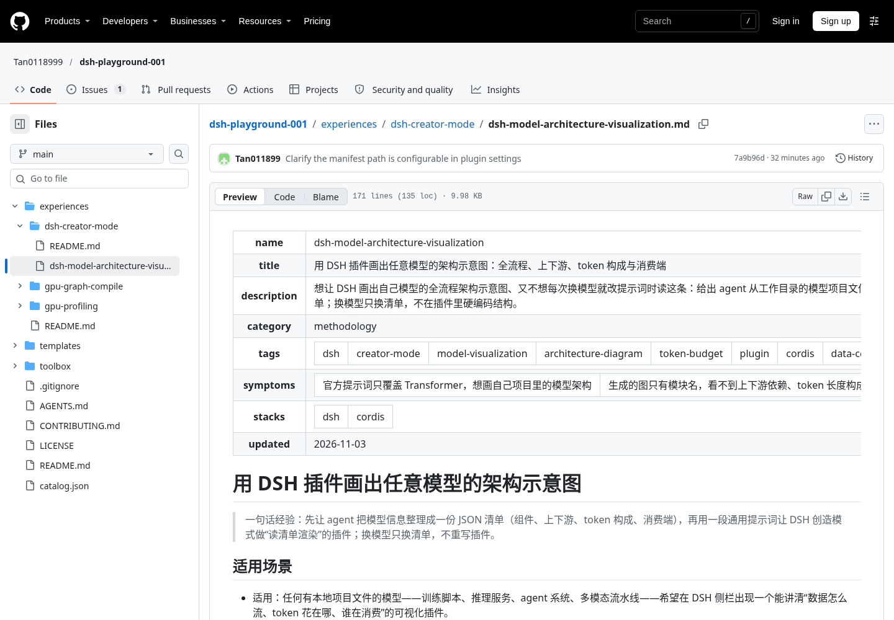
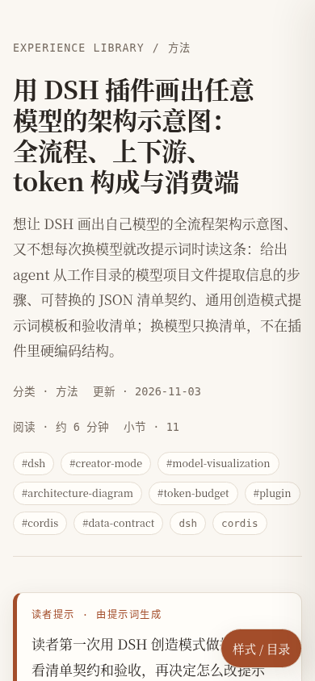
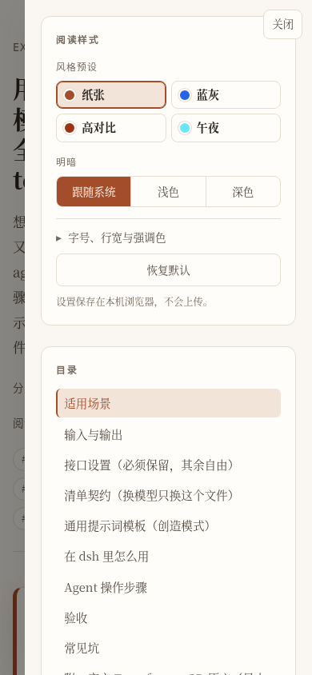

# dsh-html-experience

把经验库中的**一条** Markdown 经验渲染成可离线阅读、可转发的 HTML 阅读页。

它解决的是“经验写好了，但读者不一定在 GitHub、IDE 或 Markdown 预览器前”的问题：生成物是单个自包含 HTML，正文逐字来自源文档，附带四套风格预设和读者可调的样式面板。提示词不会被模型改写进正文，只用作页面上的“读者提示”，并在省略文档路径时参与条目匹配。

## 示例

同一篇经验（`experiences/dsh-creator-mode/dsh-model-architecture-visualization.md`）的阅读体验对比：

| Before：GitHub blob Markdown（`main @ b383662`） | After：生成页，`paper` 预设 |
| --- | --- |
|  |  |

[打开完整示例页](demo/dsh-model-architecture-visualization.paper.html) · `midnight` 深色预设：


窄屏下右下角“样式 / 目录”按钮打开同一套预设、明暗、字号和行宽控件：

| 手机正文 | 样式抽屉 |
| --- | --- |
|  |  |

## 快速开始

### 在 DSH 里安装

插件是无第三方依赖的 ESM 包，从本仓库直接装进任意 profile：

```bash
cd /path/to/dsh-playground-001
dsh plugin --profile <profile> add file:$PWD/toolbox/dsh-html-experience
```

本机 dsh 0.2.1-rc.3 上，插件管理器会把 `dsh-html-experience` 自动加入该 profile 的 `dsh.profile.bundles`；重启 dsh 后，`html_experience` 工具和 `/html` 命令生效。也可以手动在 profile 的 `cordis.patch.yml` 中加入：

```yaml
- insert:
    - id: html-experience
      name: dsh-html-experience
```

### 在对话里触发

最直接的方式是斜杠命令。命令后的自由文本是提示词，内容不限：

```text
/html -- GPU 时间线怎么看 gap，先给我一页能转给同事的阅读页
```

指定文档与风格：

```text
/html --doc experiences/gpu-profiling/nsight-systems-timeline-reading.md --style midnight -- 给第一次读 nsys 时间线的人
```

不写 `--doc` 时，插件会用提示词匹配 `catalog.json`；匹配太弱会报错并列出候选条目，而不是猜一个。选项和提示词里有 `--` 冲突时，用单独一行 `--` 分隔：

```text
/html --style slate -- 把“--force 只是覆盖文件”这句话保留在读者提示里
```

也可以不写命令，直接让 agent 调用工具，例如：“把 `experiences/dsh-creator-mode/dsh-model-architecture-visualization.md` 生成一份 HTML 阅读页，给没装 Markdown 预览器的同事。”

### 本地 CLI

不需要 DSH，也不需要 `npm install`：

```bash
node toolbox/dsh-html-experience/bin/html-experience.js \
  --doc experiences/dsh-creator-mode/dsh-model-architecture-visualization.md \
  --prompt "读者第一次用 DSH 创造模式做插件，先看清单契约和验收" \
  --style paper \
  --out /tmp/reading.html
```

`--list-presets` 列出预设，`--dry-run` 只渲染并报告目标路径、不写文件，`--json` 输出机器可读结果，`--help` 查看全部参数。退出码 0 表示成功，2 表示参数错误，1 表示文档解析或写文件失败。

## 输入与输出

### 工具 `html_experience`

| 参数 | 必填 | 说明 |
| --- | --- | --- |
| `prompt` | 是 | 读者提示/需求，自由文本、长度不限；显示在页面“读者提示”中，并在 `doc` 省略时用于匹配条目 |
| `doc` | 否 | 经验文档：工作区相对/绝对 `.md` 路径，或 `catalog.json` 里的条目名 |
| `style` | 否 | `paper`（默认）、`slate`、`contrast`、`midnight` |
| `theme` | 否 | `auto`（默认，跟随系统）、`light`、`dark` |
| `accent` | 否 | 十六进制强调色，如 `#a34d2a`，覆盖预设 |
| `width` | 否 | 正文行宽 40–120 字符 |
| `font_size` | 否 | 正文字号 12–24 px |
| `out` | 否 | 输出路径；默认 `reading-<slug>.html` |
| `title` | 否 | 页面标题覆盖 |
| `embed_images` | 否 | 默认 `true`，把本地图片内嵌为 data URI |
| `overwrite` | 否 | 默认 `false`，重名时自动加 `-2`、`-3` 后缀 |

返回值包含 `path`、`display_path`、`source`、`title`、`style`、`theme`、`sections`、`minutes`、`bytes`、`presets`、`warnings`。页面生成后，模型可以用 `present` 把它作为交付文件给读者；直接打开或转发 HTML 也可以。

### 命令 `/html`

```text
/html <提示词> [--doc <path|name>] [--style <preset>] [--theme <auto|light|dark>]
                [--accent <#rrggbb>] [--width <40-120>] [--font-size <12-24>]
                [--out <path>] [--title <text>] [--no-embed-images] [--force]
                [--list-presets] [--help]
```

`--force` 覆盖已存在的输出文件；不加时自动选择 `-2` 后缀。`--` 之后的内容原样作为提示词。

## 风格预设

每套预设同时定义字体、圆角、行宽和浅色/深色两套色板。页面里的“阅读样式”面板可以随时切换，不需要重新生成：

| 预设 | 默认 | 字体 | 浅色强调色 | 深色强调色 | 适合 |
| --- | --- | --- | --- | --- | --- |
| `paper` | 浅色 | 衬线正文 | `#a34d2a` 陶土 | `#e8a07a` | 长文、正式分享 |
| `slate` | 浅色 | 无衬线 | `#2563eb` 蓝 | `#60a5fa` | 技术文档、高信息密度 |
| `contrast` | 浅色 | 无衬线、更大字号 | `#9a3412` | `#fdba74` | 投屏、可读性优先 |
| `midnight` | 深色 | 无衬线 | `#0e7490` | `#67e8f9` | 夜间、低亮度环境 |

读者可调：预设、跟随系统/浅色/深色、字号小/中/大、行宽窄/标准/宽、自定义强调色、恢复默认。设置存在本机浏览器 `localStorage`，不上传。

桌面端样式面板在右侧栏；窄屏下右下角出现“样式 / 目录”按钮，以抽屉展示同样的控件。目录滚动高亮当前小节，顶部有阅读进度条。

## 文档匹配

省略 `doc` 时，插件从当前工作目录向上找 `catalog.json`，用提示词里的英文词和中文二元/三元组匹配条目的 `tags`、`name`、`title`、`stacks`、`description`、`symptoms`、`path`。标签/名称/标题的匹配权重最高；只有正文描述命中、没有命中任何标识字段时判为弱匹配，直接报错并提示用 `--doc`。

这样设计是为了避免“一页看起来对、其实渲染了无关经验”的静默错误。真实使用时，直接给 `--doc` 最稳。

## 实现要点

- **原文优先**：正文来自文档本身，提示词单独放在“读者提示”区块；插件不做摘要、改写或补写。
- **自包含**：CSS/JS 内联，不加载外部字体或脚本；本地图片默认转 data URI（单张上限 8 MB），所以文件可以离线打开或作为附件转发。
- **安全边界**：Markdown 和提示词先转义；链接 scheme 白名单（`http(s)`、`mailto`、相对路径）；CSP 禁止外部脚本、样式和表单；不执行文档里的 HTML。
- **渲染范围**：标题、段落、列表（含一层以上嵌套）、引用、表格、围栏代码块、分隔线、链接、图片、粗体/斜体/删除线/行内代码。代码块不做语法高亮，保留语言标签和一键复制。
- **写文件**：经 `ctx.fs` 与 `fs/write-intent` 观察策略写入；默认不覆盖已有文件，输出目录必须已存在。

### 文件结构

```text
toolbox/dsh-html-experience/
├── package.json              # dsh.bundle 指向 cordis.patch.yml
├── cordis.patch.yml          # 插入 html-experience 插件
├── lib/
│   ├── index.js              # cordis 插件：html_experience 工具 + /html 命令
│   ├── render.js             # 页面骨架、预设 CSS、读者样式控件
│   ├── markdown.js           # 带转义的 Markdown 子集渲染
│   ├── frontmatter.js        # 经验条目 frontmatter 子集
│   ├── resolve.js            # catalog 匹配与显式文档解析
│   └── presets.js            # 四套预设的字体与色板
├── bin/html-experience.js    # 无依赖 CLI
├── test/                     # node:test，37 个用例
├── demo/                     # 用真实经验条目生成的示例页
└── assets/                   # 截图
```

## 测试与验证

```bash
cd toolbox/dsh-html-experience
node --test test/*.test.js
```

覆盖：frontmatter 标量/数组、Markdown 标题/表格/代码/嵌套列表/转义与危险链接、四套预设、提示词转义、图片内嵌与失败降级、catalog 匹配的强/弱路径、工具的写文件/重名/覆盖、命令的参数解析与错误返回。另用 DSH 自带的 `assertObjectJsonSchema` / `validateJsonSchemaValue` 校验过工具参数与输出 schema，并用临时 profile 做过 `--dump-config` / `--dump-config-schema` 的组合与导入检查。

重新生成 demo：

```bash
npm run demo --prefix toolbox/dsh-html-experience
```

## 限制

- **不是 LLM 改写器**：提示词只进入“读者提示”和文档匹配；页面内容不会因提示词自动增删。需要摘要/改写时，先让模型改写 Markdown，再生成页面。
- **Markdown 子集**：不支持脚注、内嵌原始 HTML、块级引用内嵌代码块、复杂嵌套表格；这些内容会按普通文本或退化格式显示。
- **图片**：只内嵌常见位图/SVG 且不超过 8 MB；更大的文件、缺少的路径或未知类型会保留原始 URL 并给 `warnings`，不会中断生成。
- **输出目录**：`ctx.fs` 不负责建目录；`--out` 的父目录要已存在，默认写到工作目录根。
- **浏览器存储**：样式偏好按浏览器与文件来源保存；把 HTML 换机器或换浏览器后回到生成时的默认值。
- **DSH 版本**：`engines.dsh` 约束为 `>=0.2.1-rc.3 <0.3.0`，依赖 `tools`、`commands`、`fs`、`workingDirectory` 四个服务，均来自 `dsh-base`。

## 与经验库的关系

经验库的规范仍是 Markdown + `catalog.json`，这个插件只是**读者侧渲染器**：不改变条目格式，不写入 `catalog.json`，也不随条目更新自动重生成 demo。条目改了，重新跑一次 `/html` 或 CLI 即可。
